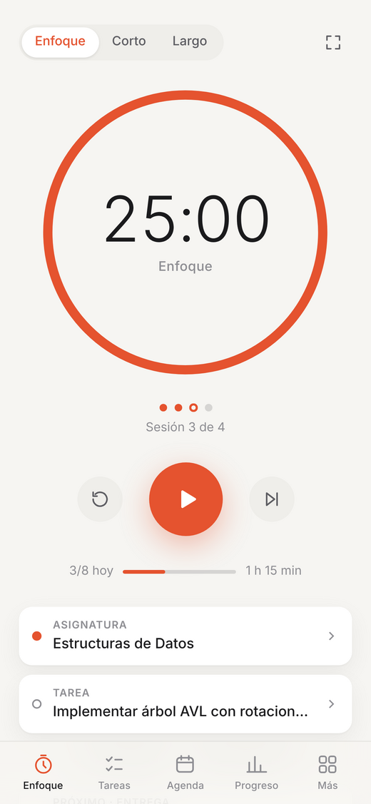
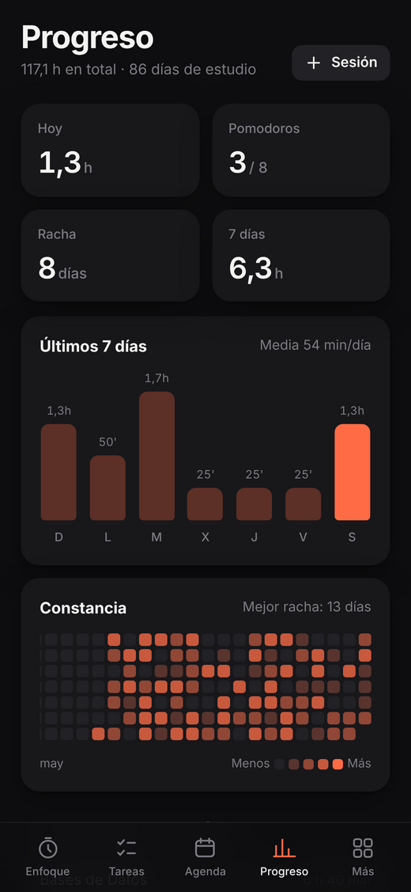
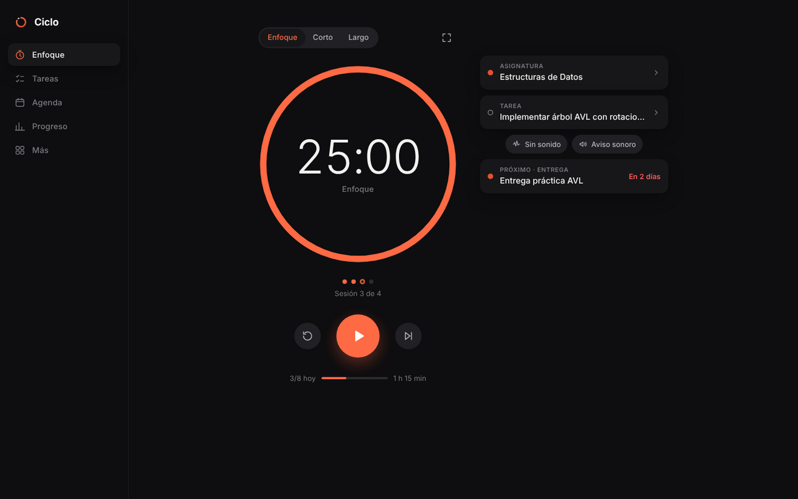

<p align="center">
  
</p>

<h1 align="center">Ciclo</h1>
<p align="center">Temporizador Pomodoro y organizador de estudio para la universidad.<br>
Minimalista, sin conexión, sin cuentas. Se instala como app en iPhone, iPad, PC y Mac.</p>

<p align="center">
  &nbsp;&nbsp;
  
</p>
<p align="center"></p>

---

## Funciones

**Temporizador**
- Ciclos de enfoque → descanso corto → descanso largo, todo configurable (duraciones, nº de sesiones por ciclo, inicio automático).
- Presets: Clásico 25/5, Profundo 50/10 (ideal para programar) y Ultradiano 90/20.
- Notificación, sonido y vibración al terminar cada fase.
- Preciso aunque cierres la app: se basa en la hora de fin, no en contar segundos.
- Modo concentración a pantalla completa, pantalla siempre encendida y cuenta atrás en el título de la pestaña.
- Ruido ambiente generado en la app (blanco, rosa, marrón), sin descargas.

**Organización**
- **Tareas** con estimación en pomodoros y progreso; elige una tarea y el tiempo se le asigna solo.
- **Asignaturas** con colores (y sugerencias típicas de Ingeniería Informática).
- **Agenda** de exámenes, parciales, entregas y prácticas con cuenta atrás y horas estudiadas de cada asignatura.
- **Apuntes** rápidos con búsqueda y modo monoespaciado para código y comandos.

**Progreso**
- Horas y pomodoros de hoy, objetivo diario y racha.
- Gráfico de los últimos 7 días, mapa de constancia de 6 meses (estilo GitHub) y reparto por asignatura.
- Sesiones manuales para el estudio hecho sin temporizador.

**Herramientas para la carrera**
- Conversor de bases: BIN, OCT, DEC, HEX, complemento a 2 (8/16/32/64 bits), con/sin signo y ASCII.
- Calculadora de calificaciones: qué nota necesitas en lo pendiente para aprobar.

**Extras**
- Tema claro, oscuro o automático. Atajos de teclado. Copia de seguridad en JSON (exportar/importar).

---

## Publicar en GitHub Pages (5 minutos)

1. Crea un repositorio nuevo en GitHub, por ejemplo `ciclo` (puede ser público o privado si tienes GitHub Pro/Education).
2. Sube **el contenido** de esta carpeta a la raíz del repositorio (`index.html` debe quedar en la raíz).
   - Desde la web: *Add file → Upload files*, arrastra todos los archivos y carpetas y pulsa *Commit changes*.
   - O desde terminal:
     ```bash
     cd ciclo
     git init && git add . && git commit -m "Ciclo v1.0.0"
     git branch -M main
     git remote add origin https://github.com/TU_USUARIO/ciclo.git
     git push -u origin main
     ```
3. En el repositorio: **Settings → Pages → Build and deployment → Source: Deploy from a branch**, rama `main`, carpeta `/ (root)` → *Save*.
4. En uno o dos minutos tendrás la app en `https://TU_USUARIO.github.io/ciclo/`.

> GitHub Pages sirve por HTTPS, que es obligatorio para instalar la app y recibir notificaciones.

## Instalarla como app

| Dispositivo | Cómo |
|---|---|
| **iPhone / iPad** | Abre la URL en **Safari** → botón *Compartir* → **Añadir a pantalla de inicio**. Abre Ciclo desde el icono y activa las notificaciones en *Más → Ajustes*. |
| **PC (Windows/Linux)** | En **Chrome o Edge**, pulsa el icono de instalar de la barra de direcciones o *⋮ → Instalar Ciclo*. |
| **Mac** | Chrome/Edge como en PC, o en **Safari**: *Archivo → Añadir al Dock*. |

Funciona sin conexión después de la primera visita.

## Notificaciones: lo que debes saber

- **PC y Mac:** la notificación llega aunque la ventana esté en segundo plano o minimizada.
- **iPhone y iPad:** iOS solo permite notificaciones a apps web **añadidas a la pantalla de inicio** (iOS 16.4 o posterior). Además, iOS congela las apps web en segundo plano: si bloqueas el móvil, el aviso del sistema no puede saltar hasta que vuelvas a abrir Ciclo. Al volver, el tiempo sigue siendo exacto y verás el aviso.
- **Aviso con el móvil bloqueado (opcional): ntfy.** Para recibir el aviso aunque Ciclo esté cerrada:
  1. Instala la app gratuita **ntfy** (App Store / Google Play).
  2. En Ciclo: *Más → Ajustes → Usar ntfy*. Se genera un tema privado; cópialo.
  3. En ntfy, suscríbete a ese tema y pulsa *Enviar prueba* en Ciclo.

  Al iniciar el temporizador, Ciclo programa el aviso en el servidor de ntfy.sh y lo cancela si pausas, reinicias o saltas la fase. Solo se envía un mensaje genérico («Enfoque completado»), nunca tus tareas ni asignaturas. Aun así, usa un tema difícil de adivinar: cualquiera que lo conozca puede leer esos avisos. Si tienes tu propio servidor ntfy puedes cambiar `ntfyServer` en el código (`js/store.js`).

## Atajos de teclado

| Tecla | Acción |
|---|---|
| `Espacio` | Iniciar / pausar |
| `R` | Reiniciar fase |
| `S` | Saltar fase |
| `F` | Modo concentración |
| `N` | Nueva tarea |
| `1`–`5` | Cambiar de sección |
| `Esc` | Salir del modo concentración |

## Tus datos

Todo se guarda en el propio dispositivo (`localStorage`); no hay servidor ni cuentas. Cada dispositivo tiene sus propios datos: para pasarlos de uno a otro usa *Ajustes → Exportar copia* y luego *Importar copia* en el otro. Exporta una copia de vez en cuando.

## Actualizar la app

Cuando cambies algo, ejecuta `node build.mjs`, sube en `sw.js` el valor de `VERSION` (por ejemplo `ciclo-v1.0.2`) y haz *push*. Los dispositivos instalados mostrarán «Hay una nueva versión de Ciclo → Actualizar».

## Estructura

```
├── index.html             Estructura y metadatos PWA / iOS
├── manifest.webmanifest   Nombre, iconos y accesos directos de la app
├── sw.js                  Service Worker: offline y clics en notificaciones
├── build.mjs              Empaqueta src/ en js/ciclo.js (sin dependencias)
├── css/styles.css         Sistema de diseño (tokens, claro/oscuro, componentes)
├── icons/                 Logo (SVG) e iconos PNG para iOS, Android y escritorio
├── js/ciclo.js            Script generado que carga la app (no editar a mano)
└── src/                   Código fuente (módulos ES)
    ├── app.js             Arranque, rutas, atajos y Service Worker
    ├── timer.js           Motor del temporizador (basado en marcas de tiempo)
    ├── store.js           Estado, persistencia, estadísticas y copias
    ├── notify.js          Notificaciones, ntfy y bloqueo de pantalla
    ├── sound.js           Campanas y ruido ambiente (Web Audio)
    ├── ui.js              Avisos, hojas modales y componentes
    ├── router.js          Rutas por hash (compatibles con GitHub Pages)
    ├── utils.js           Formato, fechas e iconos
    └── views/             Enfoque, Tareas, Agenda, Progreso y Más
```

Sin dependencias externas. Puedes abrir `index.html` con doble clic para probarla, aunque la instalación, el modo sin conexión y las notificaciones solo funcionan publicada (HTTPS) o en `localhost`.

### Modificar el código

1. Edita los archivos de `src/`.
2. Regenera el script: `node build.mjs` (requiere Node.js 18+).
3. Sube `VERSION` en `sw.js` y haz *push*.

Para probar con todas las funciones en local: `python3 -m http.server 8000` y abre `http://localhost:8000`.

## Licencia

MIT. Haz con ella lo que quieras.
